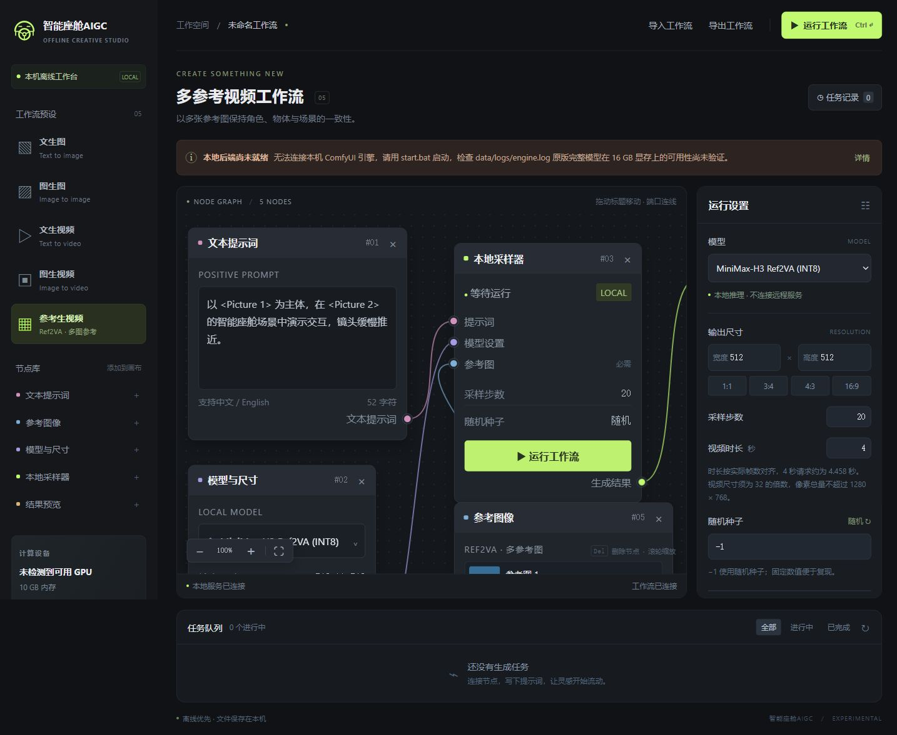
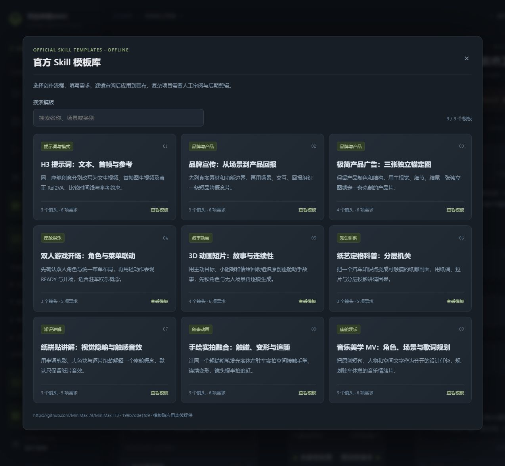

# 智能座舱AIGC · 完全本地工作台

面向 **Windows 11、RTX 4090 Laptop 16GB、64GB 内存**的部署项目。使用自制的 ComfyUI 风格节点工作台，连接同一台电脑上的 ComfyUI 原生引擎，运行 MiniMax-H3-Image 图像模型、MiniMax-H3 FL2VA 视频模型及独立的 Ref2VA 多参考视频模型。准备好依赖和权重后，可断网启动、生成、保存结果；不需要 API Key。安装入口位于仓库根目录。

**当前交付是可部署代码，尚未在目标 4090 笔记本上完成真实模型推理验证。** 这三组模型并不是能完整装进 16GB 显存的小模型：单个 INT8 DiT 约 21GB，共享文本编码器约 27.14GB，必须使用系统内存和按需卸载。64GB 内存仍可能不足，视频可能很慢或 OOM；不承诺生成速度、最大分辨率或视频时长。



开发机界面验证截图。参考图中的色块用于测试本地上传，结果区尚无模型生成内容。

## 能做什么

- H3-Image：文生图、单张参考图编辑。
- H3 FL2VA：文生视频、首帧图生视频，输出含模型生成音频的 MP4。
- H3 Ref2VA：使用独立 Ref2VA DiT，将 1–9 张参考图用于视频内容参考，输出含音频的 MP4。它不把参考图当作固定视频首帧，也不复用 FL2VA 权重代替 Ref2VA。本版只提供图片参考输入。
- 节点画布、参数编辑、任务队列、取消、进度、预览、历史记录与下载。
- 三组模型共用一个引擎，任务串行执行，每个任务后卸载模型，降低同时占用内存的风险。
- 一次准备脚本、固定核心源码提交、精确权重清单及 SHA256 校验、端口冲突检测和进程清理。

画布展示这五种受控工作流，可拖动、平移与缩放；它不支持安装任意第三方节点或自由重接完整 ComfyUI 图。可在本机 `http://127.0.0.1:8188` 查看完整 ComfyUI。

## 官方 Skill 模板工作流

在左侧或顶部打开「Skill 模板库」，可使用从 [MiniMax-H3 官方 skills](https://github.com/MiniMax-AI/MiniMax-H3/tree/199b7d0e1fd95e7b3eafa8c15eca692534142427/skills) 改编的 9 个中文模板：H3 提示词编写、极简产品广告、3D 动画短片、纸艺定格科普、品牌宣传片、音乐视频与歌词排版、双人合作游戏开场、纸张拼贴科普、手绘与实拍融合。



1. 选择模板，填写主题、角色、卖点等创作信息。
2. 查看制作步骤，选择一张概念图或一个视频分镜，预览生成提示词。
3. 点击载入画布，检查参数；需要参考图的分镜先上传图片，再运行工作流。
4. 对其余镜头重复操作；可导出整套分镜计划，也可导出当前画布工作流。

模板和表单渲染器随源码安装，断网可用，不调用在线大模型。模板保留官方流程中的策划、确认图、镜头设计和质检要点；每次只执行当前镜头，不自动分析音乐、剪辑成片或制作精确字幕。视频初始参数保守设为 512×512、4 秒，正式构图可自行修改。参见 [模板来源、适配范围与使用说明](docs/skill-templates.md)。

已有安装只需把更新后的源码放回原安装目录，保留 `engine/`、`.venv/` 和 `data/`，重启工作台并刷新浏览器即可使用模板；无需重新下载模型。

## 第一次安装：需要联网准备

推荐直接在目标笔记本准备，避免 Windows 虚拟环境跨机器或路径迁移问题。推理阶段不需要联网。若目标机从安装前就必须物理隔离，请先按 [离线转移说明](docs/offline.md) 准备依赖安装介质。

完整的 **7 个文件下载地址、官方仓库、固定版本、大小、SHA256 和存放位置**见 [模型下载与部署清单](MODEL_DOWNLOADS.md)。双击 `setup.bat` 即会按 [JSON 清单](runtime/models.json) 自动安装并下载全部模型，无需逐项操作；只准备 Ref2VA 可运行 `setup.bat -Models ref2va`。

1. 安装 [Python 3.12 x64](https://www.python.org/downloads/windows/) 和 [Git for Windows](https://git-scm.com/download/win)。保持可用的 NVIDIA 驱动；脚本不安装或更改显卡驱动、WSL、注册表和系统环境变量，也不要求单独安装 CUDA Toolkit。
2. 把本项目放在目标硬盘，建议预留 **200GB 以上空闲空间**。三组模型去重后有 **7 个权重文件，共 94,646,241,490 字节，约 94.65GB / 88.15GiB**，另需 PyTorch、引擎、下载临时文件及输出空间；完整首次安装会检查至少 150GiB 空闲。
3. 在解压或克隆得到的仓库根目录双击 `setup.bat`。它会安装两个独立虚拟环境、固定版本 ComfyUI，并下载三组权重；网络中断可再次运行。
4. 安装成功后双击 `start.bat`，浏览器打开 `http://127.0.0.1:8230`。保持启动窗口开启；按 `Ctrl+C` 同时停止界面和引擎。

也可以在 PowerShell 执行：

```powershell
.\setup.ps1
.\start.ps1
```

若系统执行策略阻止 `.ps1`，使用 `.bat`。批处理仅为当前 PowerShell 进程使用 `ExecutionPolicy Bypass`，不改变持久执行策略。

## 分步准备与常用参数

```powershell
# 使用指定的 Python 3.12；路径可包含中文和空格
.\setup.ps1 -Python "C:\Program Files\Python312\python.exe"

# 先装软件，暂不下载大文件
.\setup.ps1 -SkipModels

# 之后下载并校验三组模型；共享文件仅下载一次，SHA256 正确的文件会跳过
.\.venv\Scripts\python.exe scripts\download_models.py

# 或双击下载专用入口；它使用已有轻量 .venv，不安装 PyTorch
.\download-models.bat

# 只准备 / 启动图像模型；video 仅选择 FL2VA
.\setup.ps1 -Models image
.\start.ps1 -Models image

# 单独准备 / 启动真正的 Ref2VA 多参考视频模型
.\setup.ps1 -Models ref2va
.\start.ps1 -Models ref2va

# 只安装、查看界面，不安装引擎或下载模型，不能生成
.\setup.ps1 -UiOnly
.\start.ps1 -UiOnly

# 完全离线检查：默认仅检查是否存在及精确大小
.\.venv\Scripts\python.exe scripts\download_models.py --check
.\.venv\Scripts\python.exe scripts\download_models.py --check --sha256

# 启动前进行完整 SHA256 校验；三组全部校验读取约 94.65GB
.\start.ps1 -VerifyHashes

# 有快速 NVMe 时可试用磁盘动态卸载（需自行比较速度）
.\start.ps1 -FastDisk

# 避免默认端口占用
.\start.ps1 -StudioPort 8231 -EnginePort 8189 -NoBrowser
```

`-Models image/video/ref2va` 只选择下载和启动前预检范围；`all` 选择三组并去重共享文件。`video` 只选择 FL2VA，`ref2va` 只选择独立 Ref2VA 及其必需共享文件。界面仍展示其他模型，缺少其权重时会显示未就绪。

若只想先收集权重，可先执行 `setup.bat -UiOnly`，再运行 `download-models.bat`（或 `download-models.bat --models ref2va`）。此流程需要联网准备；下载后还须用 `setup.bat -SkipModels` 安装本地推理引擎。

## 先做一次小规模验证

关掉游戏和其他占显存程序，插电并开启笔记本性能模式。先尝试 H3-Image 的 **512×512、6 步、单张**，确认能加载、采样、解码与保存，再尝试 1024×1024。这是内存探测配置，低于模型原生最佳尺寸，不代表最佳画质。

视频从 **512×512、4 秒请求、20 步**开始。H3 使用固定 24fps、`17k+5` 帧约束，本项目向上对齐：4 秒请求生成 107 帧，实际约 **4.46 秒**。更长或更高分辨率会显著增加显存、内存与时间需求。详细限制见 [模型与兼容性研究](docs/models-research.md)。

Ref2VA 在界面选择“多参考视频”，上传 1–9 张参考图，并在提示词中描述要保留的人物、物体或场景及其动作。此模式会加载独立的 `minimax_h3_ref2va_pruned_int8_convrot.safetensors`；它以参考内容生成视频，不保证任何参考图就是输出首帧。本版不提供音频或视频参考上传。先使用简单参考和短视频验证，增加参考图也会增加编码与内存负担；目标笔记本上的可用性、速度和一致性均未保证。

默认保留 2GB 显存给系统、关闭缓存并积极卸载，使用分块 VAE 解码。当前 PyTorch 使用官方 **2.11.0 / torchvision 0.26.0 / CUDA 12.8** Windows 轮子。锁定 ComfyUI 中 Kitchen CUDA 优化要求 CUDA 13+；在这套 cu128 配置下 INT8 操作走 PyTorch eager 后备路径，可能明显变慢。源码上存在后备实现，目标硬件的功能与速度仍需要实测。

## 文件与隐私

| 路径 | 用途 |
| --- | --- |
| `web/` | 原生 HTML、CSS、JavaScript 交互界面，无 CDN |
| `backend/` | FastAPI、本地队列、引擎适配器、结果保存 |
| `runtime/models.json` | 精确仓库 revision、大小、SHA256 |
| `runtime/workflow.py` | 五种工作流的原生节点图 |
| `runtime-lock.json` | 已核实的 ComfyUI 核心提交和 PyTorch 版本 |
| `engine/ComfyUI/` | 安装时获取的官方引擎及 `models/` 权重 |
| `.venv/`、`engine/.venv/` | 界面与引擎独立 Python 环境 |
| `data/` | 任务、参考图、生成结果、日志、下载临时文件和安装记录 |

模型权重、虚拟环境、参考图、日志、生成结果不上传 GitHub。启动仅绑定本机回环地址；引擎开启 `--offline`、禁用所有自定义节点，不加载付费 API 节点，应用也不接受远程引擎地址。`HF_HUB_OFFLINE=1` 与 `TRANSFORMERS_OFFLINE=1` 在启动子进程生效。需要强制验证无外网时，完成安装后断网运行。

本项目固定核心源码和关键依赖；上游其余传递依赖由安装时解析，**不是完整可复现的全依赖锁文件**。实际安装版本保存在 `data/install/app-freeze.txt` 和 `engine-freeze.txt`，便于在测试通过后保留同一套环境。

## 验证与资料

开发检查命令：

```powershell
.\.venv\Scripts\python.exe -m unittest discover -s tests -v
# 开发测试可选安装 Node.js；本地运行工作台不需要 Node.js
node --test tests/test_templates.js
```

已通过 23 项 Python CPU 测试及 12 项 Node.js 模板测试，覆盖串行队列、取消及失联重试、OOM、任务持久化与恢复、本地地址与上传校验、原生节点图、Ref2VA 多图上传与独立权重预检、帧对齐、权重去重与完整性、端口冲突、模板同源静态分发、9 模板全部 29 镜头与后端参数兼容、官方提示词章节和字段渲染。引擎测试使用模拟服务。未执行大权重下载、完整 GPU 环境安装、离线 GPU 生成或性能测试。

遇到问题请先看 [排错](docs/troubleshooting.md)、[架构](docs/architecture.md) 和 `data/logs/engine.log` / `studio.log`。

模型和引擎属于各自发布方，使用与再分发应遵守对应仓库的许可证。主要来源：[H3-Image 官方 ComfyUI 教程](https://docs.comfy.org/tutorials/image/minimax/minimax-h3-image)、[H3 官方 ComfyUI 教程](https://docs.comfy.org/tutorials/video/minimax/minimax-h3)、[固定 ComfyUI 提交](https://github.com/Comfy-Org/ComfyUI/tree/a277b5bf213e8a44fa34817b7770b54f86ef4cea)、[PyTorch 官方安装表](https://pytorch.org/get-started/previous-versions/)。
