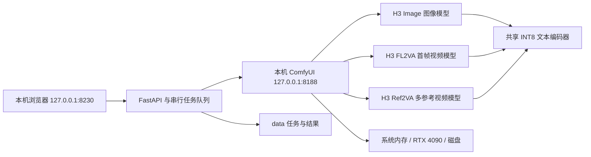

# 架构与启动行为

`start.bat` → `start.ps1` → `.venv` 中的 `scripts/launch.py`。启动器校验端口、模型文件大小、CUDA 可用性与引擎提交；需要时通过 `-VerifyHashes` 全量校验。然后以 `engine/.venv` 启动官方 ComfyUI，等 `/system_stats` 就绪，再启动 FastAPI。两个服务任一异常退出都会停止另一个；正常按 Ctrl+C 也会清理两个子进程。

启动器只终止自己创建的进程树，不接管已经占用端口的服务。全部路径通过参数数组传递，不通过 shell 拼接，支持中文和空格目录。固定源码不执行 `git pull`；安装时精确取 `runtime-lock.json` 的提交，遇到引擎已修改的跟踪文件会停止并提示。

智能座舱AIGC 前端为原生浏览器资源，不需要 Node.js、构建步骤或 CDN。后端接受有限参数，通过 `runtime/workflow.py` 构造原生 ComfyUI API 工作流。参考图先保存在本机，再发送到同机引擎；引擎输出通过其本机 `/view` 接口复制到应用结果目录。

图像、FL2VA、Ref2VA 三组有各自独立的 DiT 权重，共享 INT8 文本编码器；两个视频组还共享音视频 VAE。FL2VA 将单图用于视频首帧条件，Ref2VA 将 1–9 张图用于内容参考，使用独立的 Ref2VA 权重与对应原生条件节点。本版不提供音频或视频参考上传。下载和校验按目标文件去重，`-Models video` 不会暗中选择 Ref2VA。

任务串行执行，避免图像与视频同时加载。在任务结束时调用引擎卸载并释放内存，降低切换模型时的峰值。取消正在运行的任务会请求引擎中断；取消排队任务不应中断别的任务。CPU 测试使用模拟引擎验证这些状态转换，真实引擎中断与卸载时延需要 GPU 实测。

`--offline` 限制 ComfyUI 前端访问外网并禁用 partner 节点，`--disable-all-custom-nodes` 禁止自动加载第三方节点；默认不启动 Manager。不使用 MiniMax 云端提示词扩展、Context-IR 或云端重生成流程。本程序不替代系统级网络隔离；如需实证，安装完毕后关闭网络。
